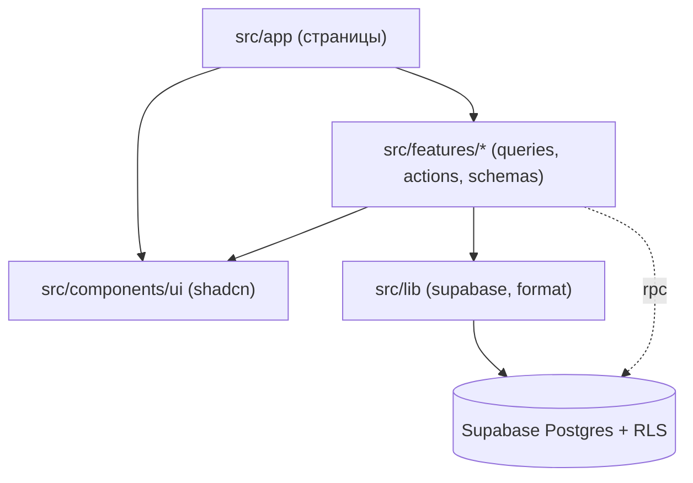
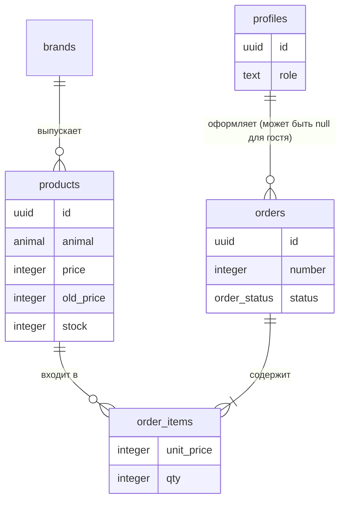
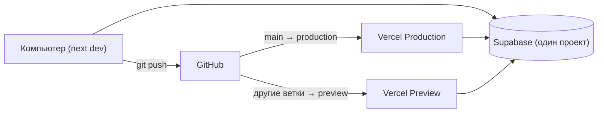

# Спина архитектуры — Мур-Гав Маркет

## Парадигма

Один проект Next.js (App Router) с тремя слоями. Зависимости идут только вниз.

| Слой | Папка | Что делает |
| --- | --- | --- |
| Маршруты (UI) | `src/app/**` | Страницы и лейауты: серверные компоненты для чтения, клиентские — для интерактива |
| Фичи | `src/features/<фича>/` | `queries.ts` (чтение), `actions.ts` (Server Actions — запись), `schemas.ts` (zod), компоненты фичи |
| Данные | `src/lib/supabase/` | Создание клиентов Supabase (server / browser / admin) |
| База | `supabase/` | Миграции SQL, RLS-политики, функции, seed |



## Решения и правила

### AD-1 — Запись в базу только через Server Actions [ADOPTED]
- **Binds:** FR-10, FR-11, FR-13, FR-14, FR-17 — FR-19
- **Prevents:** разные пути записи с разной проверкой данных
- **Rule:** клиентские компоненты не вызывают `insert/update/delete` Supabase. Любая запись — Server Action в `src/features/*/actions.ts`, который проверяет вход zod-схемой из `schemas.ts` и возвращает `{ ok: true, data } | { ok: false, error, fieldErrors? }`. Исключение — вход/выход/регистрация через Supabase Auth.

### AD-2 — Заказ создаётся одной функцией базы
- **Binds:** FR-11, FR-19
- **Prevents:** продажу товара сверх остатка; изменение цены в оформленном заказе; рассинхрон остатков при отмене
- **Rule:** заказ создаёт только Postgres-функция `place_order(items jsonb, contact jsonb)` в одной транзакции: блокирует строки товаров, проверяет остатки, берёт цены из `products`, записывает `orders` + `order_items` (с `unit_price`), списывает `stock`, считает доставку. При нехватке — исключение со списком `{product_id, available}`, ничего не пишется. Смена статуса на «Отменён» — только функция `set_order_status(order_id, status)`, которая возвращает остатки. Прямой `insert` в `orders`/`order_items` и `update` статуса запрещены политиками.

### AD-3 — Безопасность в базе, не в страницах
- **Binds:** FR-15, FR-16, FR-17 — FR-19
- **Prevents:** доступ к чужим заказам или админ-данным в обход интерфейса
- **Rule:** RLS включён на всех таблицах. Роль хранится в `profiles.role` (`'customer' | 'admin'`), проверка — SQL-функция `is_admin()`. Политики: товары и бренды — чтение всем, запись только `is_admin()`; заказы — чтение владельцу (`user_id = auth.uid()`) и админу. Проверка роли в `src/app/admin/layout.tsx` — только для редиректа. Ключ `service_role` в коде сайта не используется (кроме seed-скриптов).

### AD-4 — Корзина живёт в браузере, цены — в базе
- **Binds:** FR-8, FR-9, FR-10
- **Prevents:** устаревшие или подменённые цены в заказе; два разных формата корзины
- **Rule:** корзина — клиентский store в `src/features/cart/` с ключом localStorage `mg-cart`, формат `[{ productId: string, qty: number }]`. Цену, название и остаток корзина каждый раз получает из базы по `productId`. Сумма доставки на экране считается общей функцией `calcDelivery(subtotal)` из `src/lib/pricing.ts`; итоговую сумму заказа считает только `place_order`.

### AD-5 — Деньги и константы магазина
- **Binds:** FR-3, FR-7, FR-9, FR-11, FR-20
- **Prevents:** расхождение порога доставки и формата цен между страницами и базой
- **Rule:** все суммы — целые тенге (`integer`). Вывод — только `formatPrice()` из `src/lib/format.ts` («12 000 ₸»). Порог 12 000 и стоимость доставки 1 000 хранятся в одном месте на каждой стороне: `src/lib/pricing.ts` и таблица `settings` (её читает `place_order`). Значения обязаны совпадать.

### AD-6 — Фильтры каталога живут в адресе
- **Binds:** FR-3 — FR-6
- **Prevents:** фильтры, которые теряются при перезагрузке или не передаются ссылкой
- **Rule:** состояние каталога — только `searchParams` (`animal, age, size, type, brand, min, max, sale, q, sort, page`). Страница каталога — серверный компонент; одна функция `getCatalog(params)` в `src/features/catalog/queries.ts` разбирает параметры (zod) и строит запрос. Клиентские фильтры только меняют URL.

### AD-7 — Фиксированные словари
- **Binds:** все FR с товарами и заказами
- **Prevents:** разное написание значений в коде, базе и интерфейсе
- **Rule:** значения — Postgres enum, в коде — те же строки и русские подписи из `src/lib/dictionaries.ts`:
  `animal: cat | dog`; `age: baby | adult | senior`; `size: small | medium | large` (только при `animal = dog`, иначе `null` — CHECK в базе); `food_type: dry | wet | treat`; `order_status: new | processing | delivered | cancelled`; `payment_method: cash | card_on_delivery`.

## Соглашения

| Тема | Соглашение |
| --- | --- |
| Имена | Таблицы и колонки — `snake_case`, множественное число (`products`). Файлы — `kebab-case.tsx`, компоненты — `PascalCase`. Фича-папки: `catalog, product, cart, checkout, account, auth, admin-products, admin-orders, admin-brands` |
| ID | `uuid` для всех сущностей; у заказа дополнительно человекочитаемый `number` (последовательность от 1001) |
| Даты | `timestamptz`, вывод в часовом поясе `Asia/Almaty`, формат «09.11.2026 14:30» |
| Ошибки | Server Action возвращает `{ ok: false, error: string }` с текстом на русском для пользователя; исключения в UI не пробрасываются, показываются Toast/под полем |
| Авторизация | `@supabase/ssr`: серверный клиент в `src/lib/supabase/server.ts`, браузерный в `client.ts`, обновление сессии в `middleware.ts` |
| Конфигурация | Только переменные окружения: `NEXT_PUBLIC_SUPABASE_URL`, `NEXT_PUBLIC_SUPABASE_ANON_KEY` (публичный ключ). Секреты не коммитятся (`.env.local` в `.gitignore`) |
| Тексты и стиль | Тексты — по таблице Voice and Tone из `EXPERIENCE.md`; цвета, шрифт, скругления — токены `DESIGN.md`, перенесённые в CSS-переменные темы Tailwind/shadcn |
| Изменения схемы | Только новыми файлами миграций в `supabase/migrations/`; старые миграции не редактируются |

## Стек

| Название | Версия |
| --- | --- |
| Next.js (App Router, TypeScript) | 16.4.5 |
| React | 19.3.1 |
| Tailwind CSS | 4.3.5 |
| shadcn/ui (CLI) | 4.23.0 |
| @supabase/supabase-js | 2.119.0 |
| @supabase/ssr | 0.12.7 |
| Supabase CLI | 3.0.0 |
| zod | 4.6.7 |
| Хостинг | Vercel |
| Код | GitHub |

## Стартовая структура

### Данные



`settings` — одна строка с `free_delivery_threshold` и `delivery_fee`. `profiles` создаётся триггером при регистрации в Supabase Auth.

### Окружения



### Папки

```text
src/
  app/                 # страницы: (shop)/..., account/..., admin/..., login, register
  features/<фича>/     # queries.ts, actions.ts, schemas.ts, components/
  components/ui/       # компоненты shadcn
  components/layout/   # шапка, подвал, плашка доставки
  lib/                 # supabase/, format.ts, pricing.ts, dictionaries.ts
  middleware.ts
supabase/
  migrations/          # таблицы, enum, RLS, функции place_order / set_order_status / is_admin
  seed.sql             # 5+ вымышленных брендов, 20+ товаров, settings
```

## Где живут требования

| Требования | Где | Правила |
| --- | --- | --- |
| FR-1, FR-2, FR-20 | `components/layout`, `app/(shop)/page.tsx`, страницы delivery/payment/about | AD-5, Соглашения (тексты) |
| FR-3 — FR-6 | `features/catalog` | AD-6, AD-7 |
| FR-7 | `features/product` | AD-5, AD-7 |
| FR-8, FR-9 | `features/cart`, `lib/pricing.ts` | AD-4, AD-5 |
| FR-10 — FR-12 | `features/checkout`, функция `place_order` | AD-1, AD-2, AD-4 |
| FR-13 — FR-15 | `features/auth`, `features/account` | AD-1, AD-3 |
| FR-16 — FR-19 | `app/admin`, `features/admin-*`, `set_order_status` | AD-1, AD-2, AD-3 |

## Отложено

- **Тесты.** Набор и инструмент (Playwright и т. п.) выбираются на шаге разработки. Для учёбы достаточно ручной проверки сценариев UJ-1 — UJ-3.
- **Кэширование и производительность.** Нагрузка учебная; оптимизация не нужна.
- **Отдельная база для preview.** Один проект Supabase на всё. Разделять имеет смысл, только если появятся реальные покупатели.
- **Мониторинг и логи.** Хватает встроенных логов Vercel и Supabase.
- **Email-рассылки.** Кроме стандартных писем Supabase Auth (сброс пароля), писем нет.
- **Генерация типов TypeScript из базы.** По желанию на шаге разработки (`supabase gen types`).
